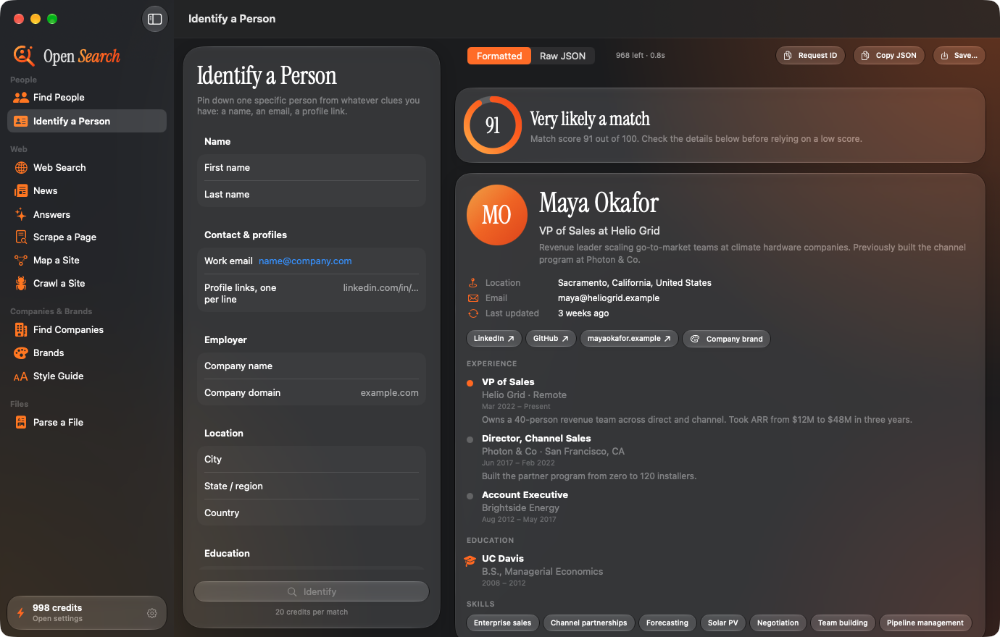
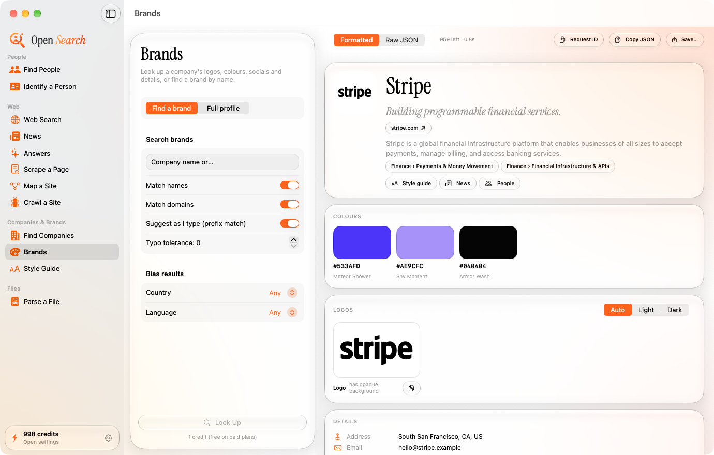

<p align="center">
  
</p>

# Open Search

A native macOS app for looking people, companies, brands and the web up through [Context.dev](https://context.dev), with every result laid out properly instead of dumped as JSON. Built in SwiftUI with Liquid Glass, an orange accent and Instrument Serif for display type.

<p align="center">
  <br>
  
</p>

*(Screenshots use synthetic data.)*

## What it covers

| Group | Tool | Context.dev endpoint |
|---|---|---|
| People | **Find People**: describe who you want by role, employer, place, skills; filter by country and experience; page through results | `POST /people/search` |
| People | **Identify a Person**: name, email, profile links, employer, location, education in; match score, experience, education and skills out | `POST /people/enrich` |
| Web | **Web Search**: freshness, country, languages, include/exclude domains, query fan-out, highlights, full-page Markdown with every content option | `POST /web/search` |
| Web | **News**: by topic or by company (name, domain, ticker, ISIN), publisher / country / language / article-type filters, date range, sort | `POST /news/search` |
| Web | **Answers**: research question to sourced answer, optional JSON Schema for the answer shape, Fast or Ultra | `POST /web/answers` |
| Web | **Scrape a Page**: Markdown, HTML, screenshot, images, highlights, structured JSON, product data, browser options | `POST /web/scrape` |
| Web | **Map a Site** / **Crawl a Site** | `GET /web/urls`, `POST /web/crawl` |
| Companies & Brands | **Find Companies**: industry, size, place, funding, "companies like…" | `POST /company/search` |
| Companies & Brands | **Brands**: autocomplete search, and full profiles by domain, name, email, ticker, URL or card transaction (logos incl. SVG, colours, socials, details) | `GET /brand/search`, `POST /brand/retrieve` |
| Companies & Brands | **Style Guide**: colours, typography, spacing, shadows, button and card components | `GET /web/styleguide` |
| Files | **Parse a File**: PDF, Office, images, text to Markdown (drag and drop) | `POST /parse` |

Every result has a **Formatted** view and a **Raw JSON** view, plus copy and save. Results hop between tools: from a person to their company's brand, from a company to its news and people, from a brand to its style guide.

Not covered (yet): batches, monitors, webhooks, logs, feedback, and the extract, fonts, NAICS and SIC endpoints.

## Setup

1. Get a key at <https://www.context.dev/dashboard/api-keys>.
2. Build and install:

   ```bash
   ./build.sh
   ```

   This needs Xcode 26+ and [XcodeGen](https://github.com/yonaskolb/XcodeGen) (`brew install xcodegen`). The app lands in `~/Applications/Open Search.app`.
3. Open the app and paste the key when it asks. It is stored in the macOS Keychain and only ever sent to `api.context.dev`. For development you can also export `CONTEXT_DEV_API_KEY`.

Credits are shown in the sidebar, and each tool shows what a request costs before you run it. Ultra answers (100 credits) ask first.

## Project layout

```
Sources/Core        JSON model, Keychain, ContextClient (Context.dev API calls), state, theme + logo, icon renderer (Debug only)
Sources/Views       window shell, shared tool layout, components, Markdown and JSON renderers
Sources/Tools       one file per tool: form, request, result view
Config              entitlements and export options for the TestFlight archive
Resources           bundled fonts, accent colour, AppIcon.icon (Icon Composer bundle)
Tools/              gen-options.py (country/language lists from the OpenAPI spec), make-icon.sh, testflight.sh
docs/               README images
```

- All Context.dev calls go through `ContextClient`. It retries 429 (honouring `Retry-After`) and 408/5xx with a short backoff, and never retries validation errors. Images from other sites load through `RemoteImage`, which keeps them in memory.
- `Tools/gen-options.py` regenerates `Sources/Core/Options.swift` from `https://docs.context.dev/openapi.json`.
- `Tools/make-icon.sh` re-renders the app icon and logo from the SwiftUI mark in `Theme.swift`.
- Debug builds accept `--tool <name> --demo [--empty] [--light]` to fill every screen with synthetic fixtures (`DemoData.swift`), which is how the screenshots above were made without spending credits.

## Credits

Instrument Serif by the Instrument Serif Project Authors, SIL Open Font License 1.1 (`Resources/Fonts/OFL-InstrumentSerif.txt`).
